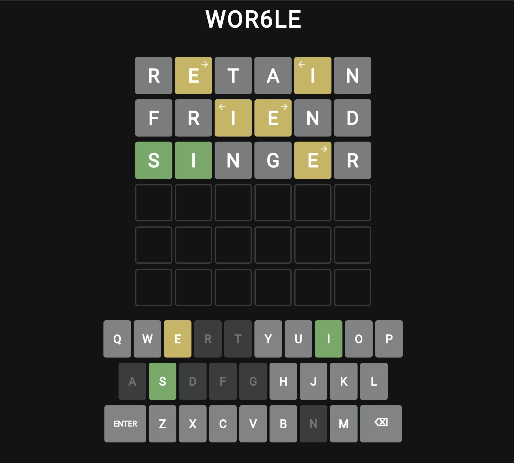

# How to play

WOR6LE is a word-guessing game like [Wordle](https://www.nytimes.com/games/wordle), with 6-letter words and arrows on yellow letters. I play Wordle often, and two things kept happening: I'd come up with 6-letter words instead of 5, and I'd get lots of yellow letters and draw a blank on where they went.

## The rules

A random 6-letter word is chosen. Guess it within 6 tries to win.

- Each guess must be a real 6-letter word. If it's too short you see **Not enough letters**; if it isn't a known word you see **Not in word list**. Either way the row shakes and the guess doesn't count.
- After each guess, the color of each tile shows how close it was.
- The on-screen keyboard colors each letter you've used the same way.

## Colors and arrows

| Color  | What it means |
| ------ | ------------- |
| Green  | The letter is in the word and in the right spot. |
| Yellow | The letter is in the word but in another spot. An arrow shows which side it belongs on. |
| Gray   | The letter is not in the word. |

Some examples, as the **How to Play** button (**?**, top right) shows them in the game:

- **W**ALNUT with W green: W is in the word and in the right spot.
- IN**D**IGO with D yellow and **←**: D is in the word, somewhere to the left.
- ARG**U**ES with U gray: U is not in the word in any spot.
- FI**L**TER with L green and **→**: L is right here, and the word has another L to the right.

## When the game ends

Win or lose, a dialog shows **Congratulations!** and how many guesses you took, or **Game Over** and the word. **Play Again** starts a new game and **View Stats** opens your statistics. The **New Game** button (**↻**, top left) starts a new game at any time.

## Statistics

The **Statistics** button (a bar chart, top right) shows games **Played**, **Win %**, **Current Streak**, **Max Streak** and a **GUESS DISTRIBUTION** of how many tries your wins took. Once a game is over, **SHARE** copies your result to the clipboard as a grid of colored squares under a line like `Wor6le 3/6`. **RESET STATISTICS** clears them after you confirm.

## Settings

The **Settings** button (a gear, top right) opens the settings:

- **Theme**: **System**, **Light** or **Dark**.
- **Color Blind Mode**: high contrast colors, orange for correct letters and blue for letters in another spot.
- **Reset Settings** puts both back to their defaults after you confirm.

Settings and statistics are saved on your device.
